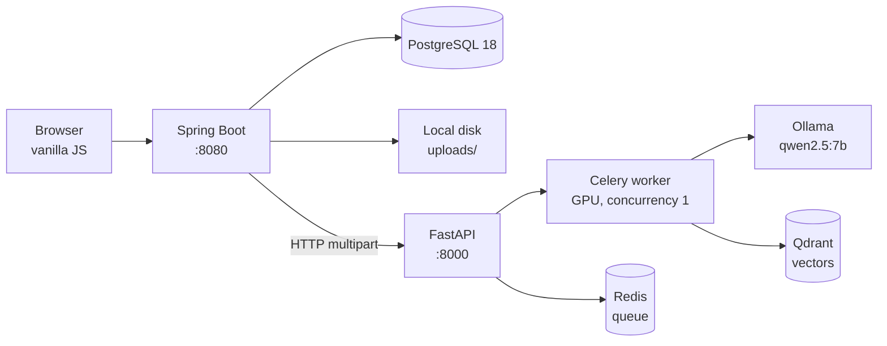

# DocuMorph

A document extraction platform that turns PDFs, scans and phone photos into
structured, searchable data — running entirely on local models, with no
third-party AI services involved.

This repository holds the **Spring Boot backend and web interface**. The
document processing itself lives in a companion service:
[documorph-nlp-pipeline](https://github.com/AtharvaS2005/documorph-nlp-pipeline).

---

## What it does

Upload a batch of documents and DocuMorph will:

- **Extract text** from digital PDFs, printer scans and photographs, routing
  each through appropriate preprocessing
- **Recover tables** as structured rows rather than flattened text
- **Pull named fields** you specify (`invoice_number, total_amount`) or answer
  free-form questions about the document
- **Accumulate results** across documents into record sets you can export as CSV
- **Answer questions** over everything you've uploaded, using retrieval-augmented
  generation scoped to your own workspace

Every model runs locally. Documents are never sent to an external API.

---

## Architecture



The two services communicate **only over HTTP** — files are transferred as
multipart uploads, never through a shared filesystem. This means the Python
service can sit on a different machine from the backend, which matters because
it needs a GPU and the backend doesn't.

### Processing flow

1. `POST /api/sessions` accepts a multipart batch, writes files to disk and
   creates one `ExtractionJob` per file
2. Each file is submitted to the Python service, which returns an external job ID
3. `JobPollingService` polls every 15 seconds for jobs still in flight
4. `JobResultProcessor` handles each job in its **own transaction**
   (`REQUIRES_NEW`), so one failure can't roll back the others
5. On completion, extracted text is indexed into Qdrant and — for record-type
   categories — appended to the relevant record set

Jobs are abandoned as `FAILED` after 45 minutes.

---

## Tech stack

| Layer | Choice |
|---|---|
| Runtime | Java 23 |
| Framework | Spring Boot 4.1.0, Spring Security 7 |
| Persistence | Spring Data JPA / Hibernate 7, PostgreSQL 18 |
| Auth | JWT (jjwt 0.12.6), BCrypt password hashing |
| Build | Gradle |
| Frontend | Vanilla JavaScript + CSS, no framework |

The frontend is deliberately dependency-free — it's served as static resources
from `src/main/resources/static/` and needs no separate build step.

---

## Getting started

### Prerequisites

- Docker Desktop
- The [NLP pipeline](https://github.com/AtharvaS2005/documorph-nlp-pipeline)
  running on the host, along with Ollama, Qdrant and Redis
- An NVIDIA GPU with roughly 8 GB VRAM for the pipeline

### Configuration

Create a `.env` file in the project root:

```env
DOCUMORPH_DB_PASSWORD=your_database_password
DOCUMORPH_JWT_SECRET=a_long_random_secret_at_least_256_bits
```

Full set of recognised variables:

| Variable | Default | Purpose |
|---|---|---|
| `DOCUMORPH_DB_URL` | `jdbc:postgresql://localhost:5432/DocuMorph_db` | JDBC connection string |
| `DOCUMORPH_DB_USERNAME` | `postgres` | Database user |
| `DOCUMORPH_DB_PASSWORD` | *required* | Database password |
| `DOCUMORPH_JWT_SECRET` | *required* | Token signing key |
| `DOCUMORPH_JWT_EXPIRATION` | `86400000` | Token lifetime, ms (24 h) |
| `DOCUMORPH_UPLOAD_DIR` | `./uploads` | Where uploaded files are written |
| `PYTHON_SERVICE_URL` | `http://localhost:8000` | Pipeline service address |

### Run

```bash
docker compose up -d
```

The application is then at **http://localhost:8080**.

PostgreSQL is published on **5433** rather than 5432, to avoid colliding with a
native Postgres install on the host. Connect pgAdmin to `localhost:5433`.

### Schema

`spring.jpa.hibernate.ddl-auto` is set to `validate` — Hibernate will **not**
create or alter tables. The schema is managed deliberately, and the application
refuses to start if the database doesn't match the entity mappings. Apply schema
changes yourself before deploying code that depends on them.

---

## API

All routes require a `Authorization: Bearer <token>` header except signup and login.

### Authentication
| Method | Path | Purpose |
|---|---|---|
| `POST` | `/api/auth/signup` | Create an account |
| `POST` | `/api/auth/setup` | Complete first-run organization setup |
| `POST` | `/api/auth/login` | Exchange credentials for a JWT |
| `GET` | `/api/users/me` | Current user and workspace |

### Documents
| Method | Path | Purpose |
|---|---|---|
| `POST` | `/api/sessions` | Upload a batch (multipart, 50 MB per file) |
| `GET` | `/api/sessions` | List sessions |
| `GET` | `/api/sessions/{id}/status` | Per-job progress |
| `GET` | `/api/sessions/{id}/results` | Extracted text, fields and tables |
| `GET` | `/api/sessions/{id}/export` | Download results as JSON, CSV or Excel (`?format=json\|csv\|xlsx`) |
| `GET` | `/api/sessions/export` | Combine several sessions into one CSV or Excel file (`?ids=…&format=…`) |
| `PUT` | `/api/sessions/{id}/files/{fileId}/fields` | Correct extracted fields; updates any linked record set |
| `DELETE` | `/api/sessions/{id}` | Remove session, files and vectors |
| `POST` | `/api/sessions/jobs/{jobId}/retry` | Resubmit a failed job |
| `GET` | `/api/files/{fileId}` | Download an original upload |
| `GET` | `/api/pipeline/health` | Whether the processing service can accept jobs |

### Categories and record sets
| Method | Path | Purpose |
|---|---|---|
| `GET` `POST` | `/api/categories` | List / create categories |
| `GET` `PUT` `DELETE` | `/api/categories/{id}` | Manage a category |
| `GET` `POST` | `/api/record-sets` | List / create record sets |
| `GET` `DELETE` | `/api/record-sets/{id}` | Read / remove a record set |
| `GET` | `/api/record-sets/{id}/export` | Download a record set as CSV or Excel |

### Search and forum
| Method | Path | Purpose |
|---|---|---|
| `GET` | `/api/search` | Find the passages most relevant to a query |
| `POST` | `/api/search/chat` | Ask a question; get a written answer citing your documents |
| `POST` | `/api/search/reindex` | Rebuild the workspace vector index |
| `GET` `POST` | `/api/forum/posts` | Organization discussion board |
| `GET` `POST` | `/api/forum/posts/{id}/replies` | Replies to a post |

---

## Data model

```
User ──< Workspace ──< UploadSession ──< FileItem ──< ExtractionJob ──< ExtractionOutput
 │                          │
 │                          └── Category ──< RecordSet
 └── Organization ──< ForumPost ──< ForumReply
```

Workspaces are the isolation boundary: every query is scoped to the caller's
workspace, and each has its own Qdrant collection named after its UUID.

`EventLog` records notable actions for the activity feed.

---

## Known limitations

Worth stating plainly rather than discovering later:

- **Processing is slow.** Roughly 15–20 minutes per document. The GPU worker runs
  at concurrency 1, so batches queue rather than parallelise.
- **No automated tests.** The project has been verified manually.
- **Signup is open.** Anyone who can reach the instance can create an account,
  and there is no email verification or per-account quota. Don't expose it
  publicly without adding both.
- **No storage limits.** Uploads are written to disk with no quota enforcement.
- **Extraction is not guaranteed accurate.** Table structure and OCR on poor
  scans remain the weakest areas. Verify anything you rely on.

---

## Related repositories

| Repository | Contents |
|---|---|
| [documorph-nlp-pipeline](https://github.com/AtharvaS2005/documorph-nlp-pipeline) | OCR, table extraction, LLM field extraction, RAG indexing |